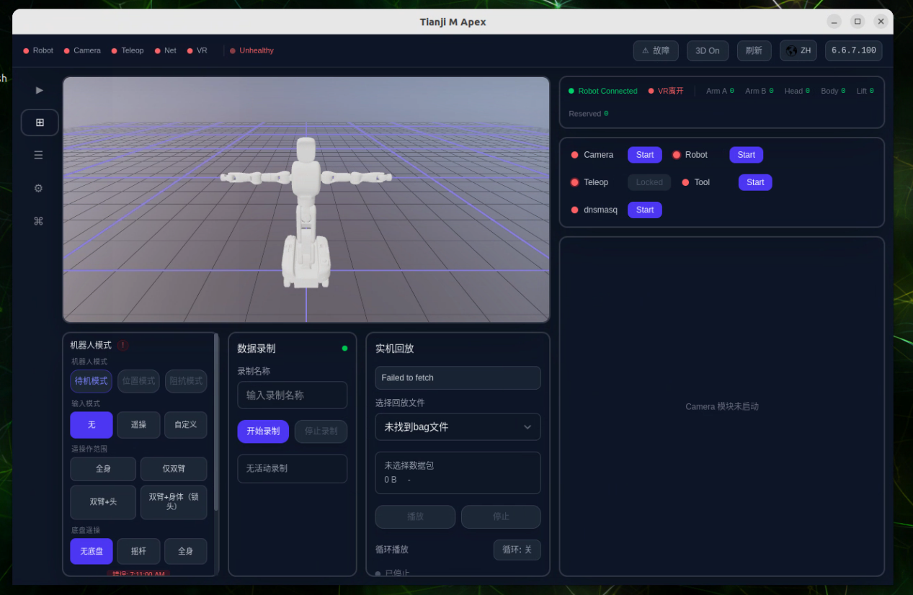
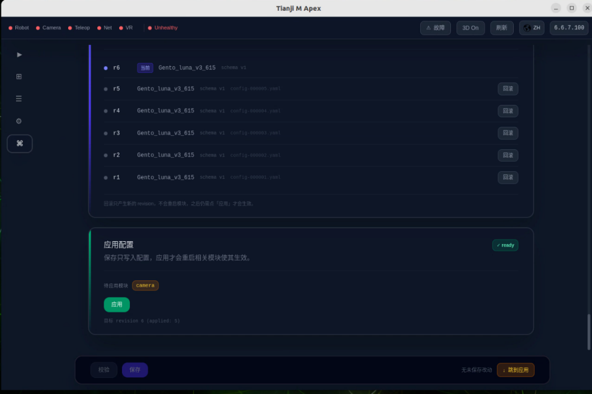
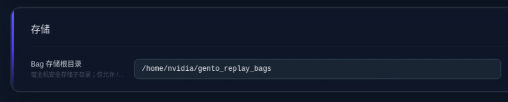

# Gento 当前版界面与操作

文档版：1.0 · 更新日期：2026-11-04。

本页适用于具有下述界面和“配置/应用”工作流的 Gento Skye/Luna 配套版本。截图来自新版界面资料，**不是所有历史安装包的能力或已就绪状态证明**；现场按钮、机型和模块以交付清单为准。旧界面见 [经典版说明](./classic)，硬件接线和账号见 [Skye/Luna 快速入门](/gento/skye-luna/getting-started/startup-debugging)。

## 1. 界面认识

:::note 此图是布局参考，不是成功状态
图中有 `Unhealthy`、`VR离开`、`Failed to fetch` 和相机未启动提示。正式操作前应按下文确认连接、反馈与所需模块就绪；不要因为界面能打开就认为机器人已经可控。
:::

| 区域 | 作用 | 操作时关注 |
|---|---|---|
| 顶部状态栏 | Robot、Camera、Teleop、Net、VR 和综合状态 | 异常状态需结合具体模块和故障查看 |
| 右上角 | 故障、3D、刷新、语言和连接 IP | 填写运行 Backend 的主控 IP，不混淆运动控制器地址 |
| 左侧导航 | 主页面、日志、配置和应用等页面 | 配置编辑不等于运行时已应用 |
| 中间 3D | 机器人姿态显示 | 与实体姿态一致，不能代替实体观察 |
| 右侧模块区 | Robot、dnsmasq、Teleop、Tool、Camera 启停 | 每步看结果，不连续盲点 Start |
| 左下机器人模式区 | 启动入口、阻抗/位置/待机、输入和遥操范围 | 服务启动、机器人 Ready、输入选择是不同步骤 |
| 录制/回放区 | 录制任务、选包、播放/停止和循环 | 先确认存储与控制权，回放可能驱动实机 |
| 视频区 | 相机画面 | 检查持续刷新及视角对应关系 |

刷新只重新读取显示状态，不修复底层故障；切换 3D 显示也不改变机器人使能。

## 2. 开始前检查

1. 确认实际机型、末端、Core/前端/Runtime/Tool 和头显版本配套。旧版没有对应按钮时，不直接套用新命令。
2. 按机型接线流程完成电源、急停、网线、相机及末端连接，清空工作空间，急停可触及。
3. 确认主控与机器人控制器的地址/网段正确；上位机连接的是运行 Backend 的主控。
4. 停止回放、自定义控制及模型程序；松开左右 VR 使能键。
5. 先准备标准初始姿态，再按交付流程进入阻抗和 Home。不要对未知初始姿态直接回零。

## 3. 模块启动与机器人准备

| 顺序 | 操作 | 下一步前确认 |
|---:|---|---|
| 1 | 打开 Apex Teleop，填写主控 IP 并连接 | 后端可访问，机型显示正确 |
| 2 | `Robot → Start` | 模块运行、机器人连接、反馈存在、无未处理故障 |
| 3 | 启动任务所需的 `dnsmasq/Net` | 使用头显网络功能时确认网络正常；已有专用网络按交付配置，不盲目改 DHCP |
| 4 | `Teleop → Start` | 不再 Locked，启动日志无错误 |
| 5 | 按需要启动 `Tool`、`Camera` | 实际末端类型正确；所需画面连续可见 |
| 6 | 点击机器人模式区域的启动入口 | 机器人 Ready，不等于仅 Robot 服务变绿 |
| 7 | 按机型流程进入阻抗模式并完成必要的 Home | 姿态安全，无故障；首次从低速小幅开始 |

Camera 或 Tool 不用于本轮任务时可不启动。不要为凑齐全部绿灯而启动不需要或未接的硬件模块。

Teleop 仍 Locked 时，先检查 Robot 连接、Ready 和故障，不反复重启所有服务。机器人、相机、末端的“进程运行”不等于对应实物通信成功。

## 4. 普通 VR 遥操

### 4.1 选择动作范围与底盘

先完成 [Pico 配置与连接](/xr-teleop/pico)。全身遥操还需交付要求的腰部和腿部追踪组件。保持左右使能均松开，再选择：

| 界面范围 | 含义 |
|---|---|
| 全身 | 双臂、头部和身体 |
| 仅双臂 | 双臂，身体和头部保持 |
| 双臂+头 | 双臂和头部，身体保持 |
| 双臂+身体（锁头） | 双臂和身体，头部保持；仅在提供该功能的版本使用 |

无底盘任务选择“无底盘”。有配套底盘时，再按交付流程选择摇杆或全身联动；上半身动作范围与底盘模式是两个不同设置。

### 4.2 选择遥操输入并小幅验证

1. 普通 VR 操作选择“遥操”输入，配套版本应为 Input `1` / IK `1`（VR）。
2. 确认 VR 已连接、追踪正常和实体姿态安全，先松开，再按下需要控制侧的使能键。
3. 先做低速小幅双臂动作，核对左右和方向；再按需要检查头部、身体、升降或下肢及末端。
4. 松开使能后确认停止跟随，再扩大工作范围。切换动作范围前始终松开两侧使能。

:::warning 普通遥操不是模型控制配置
VLA Joint 选择 user/Custom 输入，VLA EEF 使用 VLA IK；不要在 DAgger 运行中按本节随意切回 VR。模型接管/恢复按 [DAgger 使用手册](/vla/dagger) 操作，详细枚举见 [输入模式与遥操范围](./operation-modes)。
:::

## 5. 配置：校验、保存、应用

进入左侧 **Config/配置** 页面，确认当前机型后修改允许编辑的参数。涉及运动、机型、末端或存储时，先停止模型/回放/录制并使机器人处于安全状态；不要在有人靠近或正在运动时应用配置。

1. 修改参数后点击 **校验**，处理错误提示。
2. 点击 **保存**，生成新修订；这一步只保存配置，不代表运行模块已经加载。
3. 点击 **跳到应用**，查看目标修订和待应用模块。
4. 确认允许中断视频/遥操等相关功能后，点击 **应用**。
5. 确认已应用修订与目标修订一致，待应用项清空，再检查模块、反馈及参数效果。

应用可能重启相关模块。若失败，保留错误信息和修订号，查看当前已应用版本；不要反复保存新修订掩盖失败。只有准备好恢复旧参数且设备安全时，才使用页面提供的回滚流程。

## 6. 录制数据

### 6.1 设置存储

图中 `/home/nvidia/gento_replay_bags` 是配置示例，不要求所有设备使用同一路径。填写主控上实际可用的绝对目录，并完成上一节的保存/应用。

- 检查目录可写、空间足够，外接盘确已挂载。不要仅创建一个同名目录代替缺失的录制盘。
- Docker 部署还需确认该路径在运行录制的容器内可访问，不能只检查宿主机有目录。
- 存储根目录与最终 bag 目录可能不同。最终以录制状态中的 `record_dir`、`current_bag_uri` 为准，不把历史默认目录当作当前落盘位置。
- 对采用 Linux ACL/共享组权限准备流程的部署，使用支持该权限机制的文件系统；不格式化已有数据盘来试错。

### 6.2 一次录制

1. 确认没有实机回放、没有其他人正在录制；打开本任务需要的相机和反馈链路。
2. 输入清晰且不重复的任务名称，点击 **开始录制**。手柄录制键仅在已配置该映射时使用。
3. 确认录制状态和写入计数实际变化；需要视频时，同时检查相机录制与错误状态。
4. 先进行短录制，点击 **停止录制**，等待文件结束写入并读取确认。
5. 正式任务结束后同样停录、核对路径、数据、视频和任务名称，再备份归档。

只看到“开始成功”或文件夹，不代表视频、所有话题或时序对齐均已完成。DAgger 额外需要检查干预区间和录制归属，见 [DAgger 数据检查](/vla/dagger#8-数据检查与归档)。

## 7. 实机回放

:::danger 回放会控制实体机器人
播放不是只看 3D 动画。首次回放不启用循环，清空工作空间、准备急停，并确认包的机型、初始姿态、工具和控制范围匹配。未知来源或不匹配的包不直接播放。
:::

1. 停止模型、自定义目标和 VR 操作，松开使能；停止录制，确认没有其他程序争用控制权。
2. 按交付流程准备匹配且安全的初始姿态及允许的低速设置，不通过强行拖动抵消回放。
3. 在实机回放区选择已验证的数据包，确认文件可读取、内容和作用范围符合本轮任务。
4. 关闭循环，点击 **播放**，监护首次跟随和真实反馈。出现跳变、方向异常或障碍物立即停止；紧急情况使用物理急停。
5. 点击 **停止** 后确认回放确已结束、机器人停止跟随，再选择下一项任务。不要在回放运行时开启模型或手动改源。

不要假定每种包都会回放所有关节、图像或末端。按该交付版本支持的回放类型核对；视频录制成功不等于视频会驱动机器人回放。

## 8. 停止与快速排障

结束操作：松开 VR 使能并停止模型/自定义动作，停止回放和自己的录制，确认文件结束写入；按现场流程将输入切到安全状态、机器人待机，最后停止不再需要的模块。模块 Stop、Input=None 和物理急停含义不同。

| 现象 | 优先检查 |
|---|---|
| 顶部 Unhealthy | 查看具体故障、所需模块及新鲜反馈；不要只刷新 |
| Teleop Locked | Robot 模块、控制器连接、Ready 和故障 |
| VR 离开/无动作 | Pico 网络、追踪、阻抗、Input/IK、动作范围及使能键 |
| 只有手臂动 | 全身范围、追踪组件及机型配置，不立即改运动增益 |
| Camera 无画面 | Camera 日志、连接、发布状态及实际码流 |
| Failed to fetch | 对应 Backend/录制接口、主控 IP、网络和服务日志 |
| 参数保存后没变化 | 是否执行应用、已应用修订、待应用模块及应用失败信息 |
| 有 bag 没视频 | 相机录制状态、错误和实际视频文件；两条链路分别检查 |
| 录制路径找不到 | 状态中的实际路径、容器映射、外接盘挂载和权限 |

排查时提供：机型、软件版本、操作时间、完整错误、操作前后状态及对应模块日志。更多只读检查见 [Gento 模块化通讯排查](/advanced/gento-communication-diagnostics)，接口定义见 [Gento ROS 2 接口](./gento-interfaces)。
