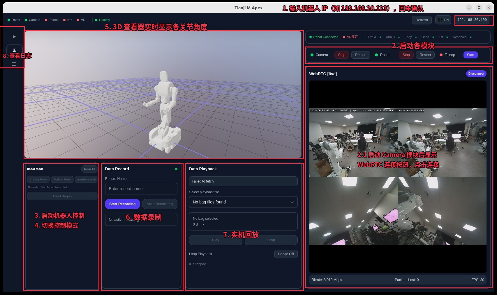

# Classic Apex Teleop Interface

This page retains instructions for historical Orin-based Marvin Pro systems and Skye/Luna deliveries using the classic interface. For the newer matched Skye/Luna interface, configuration save/apply, recording, and playback, see [Current Gento Interface and Operation](./gento-current). Follow the delivery manifest and actual interface rather than mixing controls or defaults from different releases.

## Connect and start

1. Enter the controller IP in the upper-right field and press Enter.
2. Start **Robot** and verify that the 3D model matches the physical robot.
3. Start **Teleop** and the network module required by the product quick start. Camera is optional.
4. Click **Start Robot** or the corresponding robot start control.
5. Select **Impedance Mode**, then execute **Home**.
6. Connect the headset and start teleoperation.

Skye/Luna uses Pico with full-body trackers. Historical Marvin Pro systems use Pico or Meta Quest according to the delivered configuration.

## Main areas

| Area | Description |
|---|---|
| Status bar | Robot, Camera, Teleop, Net, VR, and Healthy status |
| 3D Viewer | Live robot joint pose |
| Module Control | Start, stop, or restart Camera, Robot, and Teleop |
| Robot Mode | Start the robot, select Standby/Position/Impedance, and Home |
| Data Record | Name, start, and stop a recording |
| Data Playback | Select and play recorded data |
| WebRTC | Connect to and display camera video |
| Log | Select a module and inspect runtime logs |

## Recording and playback

The defaults below apply only to this historical deployment. Verify newer storage roots and container paths in [Current Gento recording instructions](./gento-current#6-record-data); not every release requires a USB drive with the same label.

Before recording, confirm that the USB drive labeled `BAG_STORAGE` is mounted and check Camera state. Enter a recording name, click **Start Recording**, then click **Stop Recording** when finished. Data is stored by default in `/media/<user>/BAG_STORAGE/recorded_bags`. For playback, select a recording and use **Play**, **Stop**, and the loop option.

To determine whether a topic is permitted for recording, playback, or frontend forwarding, see [Topic whitelist configuration and diagnostics](/advanced/topic-whitelist).

Physical playback can move the robot. Verify the initial pose, workspace, and emergency stop first.

## Logs

Open the log page from the side navigation and select Robot, Teleop, Camera, or the network service. Record the fault time and retain the relevant log output when a module fails, VR cannot connect, or video is unavailable.
