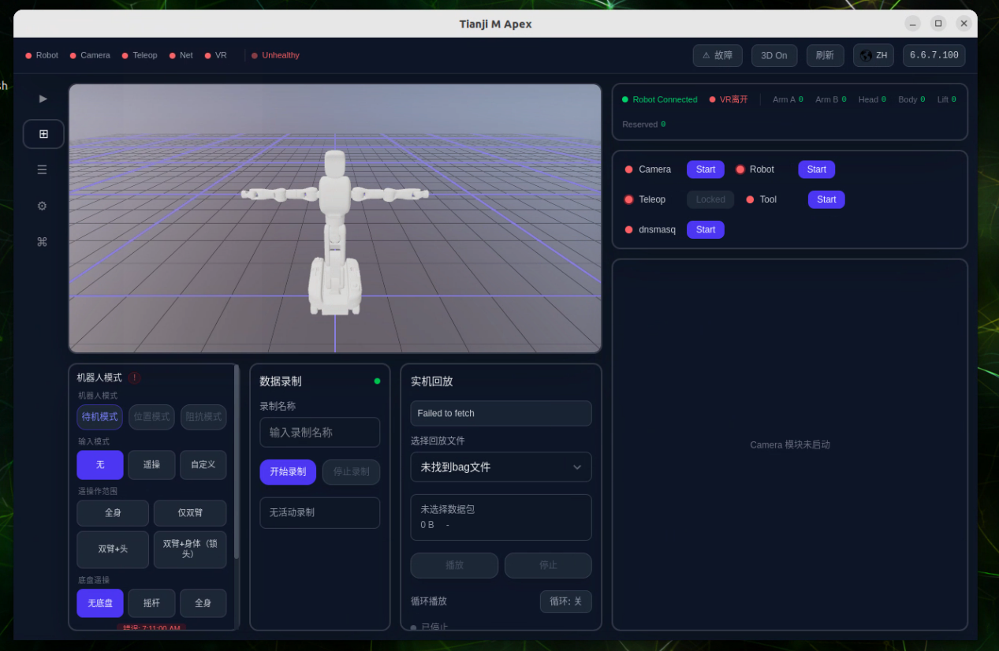
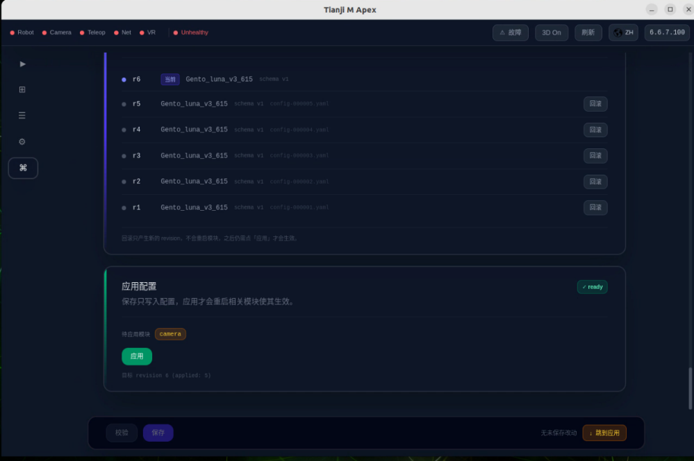
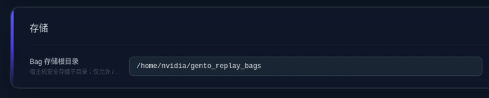

# Current Gento Interface and Operation

Document version: 1.0 · Updated: 2026-11-04.

This page applies to matched Gento Skye/Luna deliveries with the interface and configuration/apply workflow shown below. The screenshots illustrate the newer interface; **they do not prove readiness or support in every historical package**. Controls, models, and modules follow the delivery manifest. See [Classic Interface](./classic) for older interfaces and [Skye/Luna Quick Start](/gento/skye-luna/getting-started/startup-debugging) for wiring and accounts.

## 1. Interface Overview

:::note Layout reference, not a successful operating state
The screenshot contains `Unhealthy`, VR disconnected, `Failed to fetch`, and a stopped-camera message. Before operation, verify connections, feedback, and all required modules below. Opening the interface does not mean the robot is ready for control.
:::

| Area | Purpose | What to verify |
|---|---|---|
| Top status bar | Robot, Camera, Teleop, Net, VR, and overall state | Investigate the specific module and fault |
| Upper right | Faults, 3D, refresh, language, and connection IP | Address of the main controller running Backend, not the motion controller |
| Side navigation | Main view, logs, configuration, and apply pages | Editing configuration is not applying it |
| Center 3D | Robot pose display | Agreement with the physical robot; not a substitute for observation |
| Module area | Robot, dnsmasq, Teleop, Tool, Camera start/stop | Verify each result rather than repeatedly clicking Start |
| Robot-mode area | Robot start, impedance/position/standby, input, and range | Service startup, robot Ready, and source selection are separate steps |
| Record/playback area | Name recordings, select bags, play/stop, and loop | Check storage and ownership; playback can move real hardware |
| Video area | Camera images | Continuous updates and correct view mapping |

Refresh only reloads displayed state; it does not repair a fault. Toggling the 3D display does not enable the robot.

## 2. Before Startup

1. Verify the physical model/Tool and the matched Core/frontend/Runtime/Tool/headset release. Do not apply new commands to a version without the corresponding controls.
2. Follow product wiring for power, emergency stop, network, cameras, and Tool. Clear the workspace and keep the emergency stop accessible.
3. Verify main-controller and motion-controller addressing/subnets. Apex connects to the main controller running Backend.
4. Stop playback, custom targets, and model programs. Release both VR enable buttons.
5. Prepare the standard initial pose before impedance/Home according to delivery procedure. Do not Home from an unknown pose.

## 3. Start Modules and Prepare the Robot

| Order | Action | Check before continuing |
|---:|---|---|
| 1 | Open Apex Teleop, enter the main-controller IP, and connect | Reachable Backend and correct model |
| 2 | `Robot → Start` | Running module, controller connected, valid feedback, and no unresolved faults |
| 3 | Start required `dnsmasq/Net` | Headset network works; follow dedicated-network configuration rather than changing DHCP blindly |
| 4 | `Teleop → Start` | No longer Locked and no startup errors |
| 5 | Start required `Tool` and `Camera` | Correct physical Tool and continuous required video |
| 6 | Use the start control in the robot-mode area | Robot Ready, not merely a green Robot service indicator |
| 7 | Enter impedance and complete required Home for the robot | Safe pose and no faults; start with small, slow tests |

Leave Camera or Tool stopped if the task does not need it. Do not start unused or disconnected hardware solely to turn every indicator green.

If Teleop stays Locked, inspect Robot connection, Ready, and faults instead of restarting everything. A running process does not establish physical communication with a robot, camera, or Tool.

## 4. Ordinary VR Teleoperation

### 4.1 Motion range and base

Complete [Pico setup and connection](/xr-teleop/pico). Full-body operation also requires the delivered waist/leg trackers. Release both enable buttons before selecting:

| Range | Meaning |
|---|---|
| Full body | Arms, head, and body |
| Arms only | Arms; hold body and head |
| Arms + head | Arms and head; hold body |
| Arms + body (head locked) | Arms and body; hold head, only on versions offering this mode |

Choose "No base" for tasks without base operation. With a delivered base, select joystick or whole-body coupling according to its procedure. Upper-body range and base mode are separate settings.

### 4.2 Select VR input and verify small motions

1. Select Teleop input for ordinary VR operation; the matched version uses Input `1` / IK `1` (VR).
2. Verify VR connection, tracking, and a safe physical pose. Release, then press the enable button for the required side.
3. Verify small, slow arm motions and left/right direction first, then the required head, body, lift/lower-body, and Tool mapping.
4. Confirm following stops when enable is released before increasing motion range. Release both enables before changing range.

:::warning Ordinary VR setup is not model setup
VLA Joint uses user/Custom input; VLA EEF uses VLA IK. Do not manually apply this section during DAgger operation. Follow [DAgger User Guide](/vla/dagger) for intervention/recovery and [Input Modes and Motion Range](./operation-modes) for enumerations.
:::

## 5. Configuration: Validate, Save, Apply

Open **Config** from the side navigation and verify the model before editing permitted parameters. For motion, model, Tool, or storage changes, stop model/playback/recording activity and make the robot safe first. Never apply configuration while the robot is moving or people are nearby.

1. Edit parameters, click **Validate**, and resolve errors.
2. Click **Save** to create a revision. This writes configuration but does not mean running modules have loaded it.
3. Click **Jump to Apply** and inspect the target revision and pending modules.
4. Confirm that interruption of video/teleoperation and related modules is acceptable, then click **Apply**.
5. Verify that the applied revision matches the target and pending items are cleared; recheck modules, feedback, and actual parameter effect.

Applying may restart affected modules. On failure, retain the error and revision number and inspect the applied revision. Do not repeatedly save new revisions to obscure the failure. Use the provided rollback workflow only after preparing the previous settings and making the device safe.

## 6. Record Data

### 6.1 Storage settings

`/home/nvidia/gento_replay_bags` in the screenshot is an example, not a required path for every device. Set an actual usable absolute path on the main controller, then save/apply as above.

- Verify write permissions, free space, and actual external-drive mounting. A same-named local directory is not a substitute for a missing recording drive.
- In Docker deployments, the recorder container must also access the path; host existence alone is insufficient.
- The storage root and final bag directory may differ. Use actual `record_dir` and `current_bag_uri` rather than assuming a historical default.
- Deployments using Linux ACL/shared-group preparation require a filesystem supporting those permissions. Do not format existing data drives as a troubleshooting experiment.

### 6.2 One recording

1. Confirm no playback or another person's recording is active. Start the camera and feedback paths required for the task.
2. Enter a clear, unique task name and click **Start Recording**. Use headset recording keys only if that mapping is configured.
3. Verify actual recording state and increasing written-message counts. For video, also inspect camera-recording state and errors.
4. Make a short test, click **Stop Recording**, wait for finalization, and read back the files.
5. For production runs, stop recording, verify paths/data/video/task name, and archive a backup.

A successful start or an existing directory does not establish complete video, topics, or alignment. DAgger also needs intervention intervals and recording ownership; see [DAgger Data Checks](/vla/dagger#8-data-checks-and-archiving).

## 7. Physical Playback

:::danger Playback controls the real robot
Play is not merely a 3D animation. Disable looping for the first run, clear the workspace, prepare the emergency stop, and verify the bag's robot model, initial pose, Tool, and control scope. Do not directly play unknown or mismatched recordings.
:::

1. Stop model/custom targets and VR operation, release enable, stop recording, and eliminate competing controllers.
2. Prepare the safe matching initial pose and approved low-speed settings according to delivery procedure. Never resist playback by forcibly pushing the robot.
3. Select a verified recording. Check readability, content, and the intended control scope.
4. Disable looping and click **Play** while supervising initial following and real feedback. Stop on jumps, wrong directions, or obstacles; use the physical emergency stop for hazards.
5. After **Stop**, confirm playback and physical following have ended before the next task. Do not start a model or manually switch sources during playback.

Do not assume every bag replays all joints, images, or end effectors. Verify the replay types supported by the delivered release. Recorded video does not imply video-driven robot playback.

## 8. Stop and Troubleshoot

To finish, release VR enable and stop model/custom actions, playback, and your own recording. Confirm files are finalized, set input and robot standby according to site procedure, and stop unneeded modules. Module Stop, Input=None, and physical emergency stop have different meanings.

| Symptom | First checks |
|---|---|
| Unhealthy status | Specific faults, required modules, and fresh feedback; not just refresh |
| Teleop Locked | Robot module, connection, Ready, and faults |
| VR disconnected/no motion | Pico network, tracking, impedance, Input/IK, range, and enable |
| Arms move but body does not | Full-body range, trackers, and model configuration before changing gains |
| No camera video | Camera logs, connections, publisher, and actual stream |
| Failed to fetch | Relevant Backend/recording endpoint, IP, network, and service logs |
| Saved parameters have no effect | Apply operation, applied revision, pending modules, and failure details |
| Bag but no video | Actual camera recording, errors, and files; inspect both paths separately |
| Recording path not found | Actual reported path, container mounts, drive mount, and permissions |

Provide model, versions, operation time, complete error, before/after state, and module logs for support. See [Gento Communication Diagnostics](/advanced/gento-communication-diagnostics) for read-only checks and [Gento ROS 2 Interfaces](./gento-interfaces) for definitions.
