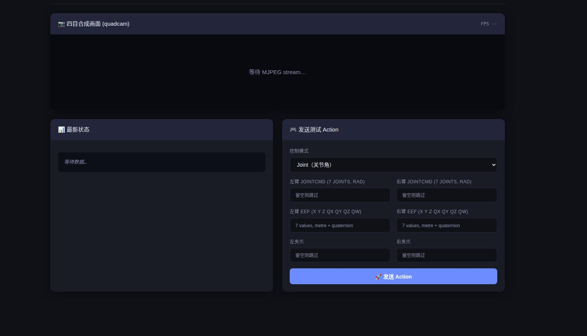

# Gento DAgger User Guide

Document version: 1.0 · Updated: 2026-11-04.

This guide applies to **Gento Skye/Luna deliveries that include the DAgger feature**. It covers VR corrections during model execution, returning control to the model, and checking intervention data. For ordinary teleoperation and interface controls, see [Current Gento Interface and Operation](/software/apex-teleop/gento-current).

:::note Verify the matched delivery
Use the Core, Apex Teleop frontend, Runtime, Tool, headset client, and VLA Host versions listed in the delivery manifest. This guide does not imply that every historical Gento package supports DAgger. If an interface is missing, confirm the matching packages with support; do not replace the SDK or start a second robot driver.
:::

## 1. Features and Responsibilities

```text
Customer model -> VLA Host -> Selected control source -> Robot
                                    |
                           Switch to VR for intervention
                                    |
                           Gento Replay + camera recording
```

| Component | Responsibility |
|---|---|
| Robot and Teleop | Robot feedback, source arbitration, and teleoperation/IK |
| VLA Host | Accept model actions, suppress them during intervention, and coordinate intervention, recovery, and recording |
| Gento Replay | Record robot data, coordinate camera recording, and report state and paths |
| Customer model client | Read observations, run inference, produce safe targets, and discard stale queued actions after intervention |
| Operator | Supervise safety, correct with VR, and verify recovery conditions and data completeness |

The supplied `client.py` is an integration template. By default it returns a dictionary whose action fields are all `None`; it does not run a real model. Integrate the customer model or use a separately supplied, adapted model client. This feature does not automatically train a model, retrain on collected data, or update a checkpoint.

## 2. Safety and Preconditions

1. Clear the workspace and assign a person who can immediately operate the physical emergency stop. Use the low-speed, small-motion settings approved for the delivery during initial testing.
2. Complete power-on, Ready, impedance mode, and the required initial-pose preparation for the robot. Do not execute Home from an unverified pose.
3. Connect Pico and the required trackers. Independently verify small VR motions and end-effector directions before model operation.
4. Stop playback and other action publishers. Only the current model and the supervised VR intervention path may participate in control.
5. Keep model output disabled and the input in a safe state. Do not start an action-producing model before system checks.
6. Verify the recording path, space, permissions, and a short recording containing readable robot data and video.

:::danger B is not an emergency stop
`B` requests an intervention/recovery transition; it is not a hard-real-time safety button. Slow inference, image reads, or network waits can delay processing. It may also be unavailable without an interactive terminal or terminal focus. For collision, trapping, or loss-of-control hazards, use the physical emergency stop rather than waiting for a key, HTTP, or recording response.
:::

`Input=None` only stops forwarding the corresponding joint input. It **does not mean disable, power-off, or stopping every end-effector output**, and cannot replace an emergency stop.

## 3. Addresses, Terminals, and Software Checks

### 3.1 Where commands run

| Terminal | Location | Purpose |
|---|---|---|
| Main-controller terminal | Tianzhun/Orin/Thor host OS | Docker management, Host startup, and HTTP checks |
| ROS terminal | Running Teleop container or matched native ROS environment | `ros2` checks and control-source selection |
| Model terminal | Customer model computer | Inference client and `B` hotkey; keep focus here |

| Service | On the main controller | From the model computer |
|---|---|---|
| VLA Host | `http://127.0.0.1:8000` | `http://MAIN_CONTROLLER_IP:8000` |
| Gento Replay | `http://127.0.0.1:8012` | `http://MAIN_CONTROLLER_IP:8012` |
| Apex Backend | `http://127.0.0.1:8080` | `http://MAIN_CONTROLLER_IP:8080` |

The main-controller IP is the address of the computer running Host, not the robot's internal motion controller. Ports follow the delivery configuration. The default ROS namespace is `/tj`; it is not part of HTTP URLs. Use trusted local networks only and never expose action ports to the public Internet.

### 3.2 Prepare a ROS terminal

Start Robot, Teleop, and the Camera/Tool modules required by the task from Apex. Check for startup errors. For Docker deployments, open a **main-controller host terminal**:

```bash
sudo docker ps --format 'table {{.Names}}\t{{.Status}}'
sudo docker exec -it apex-teleop \
  /usr/local/bin/apex-runtime-entrypoint bash --noprofile --norc
```

Replace `apex-teleop` with the actual container name if different. Only after entering it should you run commands marked "ROS terminal". Do not run them directly on a host without the matching ROS environment.

**Native alternative:** run `source /etc/apex/apex_ros_env.sh` in a main-controller terminal with the matched ROS packages installed, then use it as the ROS terminal. Do not mix native and container drivers.

### 3.3 Check services and keep input closed

**ROS terminal:**

```bash
ros2 node list
ros2 service type /tj/control/set_input
ros2 service type /tj/control/set_ik_input
ros2 service type /tj/control/gento_replay/record
ros2 service type /recorder/set_recording
```

The first three service types must be `marvin_msgs/srv/Int`; the camera-recording service must be `marvin_msgs/srv/VideoCapture`. Investigate duplicate nodes or services instead of starting another recorder.

With model output still disabled, the robot stationary, and the operator confirming safety, keep input closed:

```bash
ros2 service call /tj/control/set_input marvin_msgs/srv/Int '{data: 0}'
ros2 service call /tj/control/set_ik_input marvin_msgs/srv/Int '{data: 0}'
```

Check `success` in each response. Stop the procedure if a service is missing or fails; do not enable model control.

## 4. Start Host and Check Recording

### 4.1 Gento Replay

Teleop may already include Gento Replay. Check its nodes and recording service first. Only if it is not running, start it in **another ROS terminal**:

```bash
ros2 launch gento_replay gento_replay.launch.py apex_ros_namespace:=tj
```

Keep this terminal running. For standalone launches, verify that `record_dir` agrees with the interface storage setting. Use the reported `record_dir` and `current_bag_uri`; do not infer the path from a folder name.

### 4.2 VLA Host

For Docker, run in a **new main-controller host terminal** and keep it running:

```bash
sudo docker exec -it apex-teleop /usr/local/bin/apex-runtime-entrypoint \
  ros2 launch vlahost vlahost_server.launch.py \
  apex_ros_namespace:=tj host:=0.0.0.0 port:=8000
```

For native deployments, run the same `ros2 launch` in a prepared ROS terminal without `docker exec`. `body_joint_num` is `3` for Skye and `6` for Luna. The matched launch selects it from the model; delivery staff must explicitly verify it if the model environment is not configured correctly.

### 4.3 Read-only preflight

**Main-controller host terminal:**

```bash
VLA_URL=http://127.0.0.1:8000
GENTO_URL=http://127.0.0.1:8012
BACKEND_URL=http://127.0.0.1:8080

curl -sS --max-time 5 "$VLA_URL/health" | python3 -m json.tool
curl -sS --max-time 5 "$VLA_URL/state" | python3 -m json.tool
curl -sS --max-time 5 "$VLA_URL/intervention/status" | python3 -m json.tool
curl -sS --max-time 5 "$GENTO_URL/api/gento_replay/status" | python3 -m json.tool
curl -sS --max-time 5 "$BACKEND_URL/api/v1/robot/status" | python3 -m json.tool
```

Set these URLs again in every new terminal. From the model computer, replace `127.0.0.1` with the main-controller IP.

| Check | Pass condition |
|---|---|
| Host | `/health` responds; this alone does not establish robot or recorder health |
| Feedback | Valid joint/EEF fields and continuously fresh source timestamps; unchanged values while stationary are normal |
| Images | `http://MAIN_CONTROLLER_IP:8000/stream/quad.mjpg` displays continuously updating images |
| Intervention | Initially `active=false`, `transitioning=false`, with no unresolved errors |
| Recording | `record_service_available=true`, fresh status, and `playback_active=false` |
| Storage | Writable actual path, sufficient space, and readable data/video after a short recording |

`/state.stamp` is the snapshot time, not each sensor's sample time. Receiving snapshots continuously does not prove that every feedback source is updating.



This is a layout reference. "Waiting for data/video" is not a pass condition. Read feedback on the left. Choosing Joint/EEF on the right changes the action format; it **does not switch the robot's control source**. Use a hold target based on current feedback for the first test, never arbitrary example coordinates.

## 5. Prepare the Model and Enable Control

### 5.1 Model-computer setup

Use the delivered `vlahost/client.py` and `client_requirements.txt`. Run these commands in the **client directory containing those delivered paths**. Access to an internal source repository is not required:

```bash
python3 -m venv .venv
source .venv/bin/activate
pip install -r client_requirements.txt
```

Joint actions are absolute angles for 7 joints per arm, in rad. EEF actions are absolute base-frame poses `[x,y,z,qx,qy,qz,qw]`, with position in m. End-effector ranges follow the matched Tool; do not assume every device accepts `0~1`. Never mix Joint and EEF targets in one action.

### 5.2 First integration sequence

1. Keep input safe and model output disabled. Complete preflight and short-recording checks in Section 4.
2. Verify observations, action format, arm order, frames, and Tool mapping. Prepare a current-pose hold target and do not output test gripper targets.
3. With operator approval, start the client with verified, continuous current-pose hold targets, then select the matching source below.
4. Check actual source, feedback, and target continuity. Begin with delivery-approved small, slow motions only.
5. Complete one short "model -> intervention -> inference from new observations -> recovery" cycle before production collection.

Run in the **model-computer terminal**, replacing the main-controller IP:

```bash
python3 vlahost/client.py --server-url http://6.6.7.100:8000 \
  --control-mode eef --intervention-key b --rate-hz 10
```

Use `--control-mode joint` for Joint models. This command has no safe dry-run switch; the integrated inference program determines whether actions are sent. The example `10 Hz` is not an acceptance rate for all models. EEF Host defaults to `50 Hz` output and stops that output after `0.5 s` without a fresh target. Joint publishes received actions and does not share the EEF timeout-stop guarantee. Set model rate, trajectory continuity, and safety constraints according to delivery validation.

### 5.3 Select the model control source

Use these commands only for the initial baseline. Host manages subsequent intervention/recovery; do not manually change mux sources concurrently.

| Mode | Input | IK source | Order |
|---|---:|---:|---|
| Model EEF | `1`, Teleop/QP | `2`, VLA | IK first, then Input |
| Model Joint | `3`, user | `0`, Idle | Input first, then IK |
| Human VR | `1`, Teleop/QP | `1`, VR | Switched by Host |

**ROS terminal, EEF alternative:**

```bash
ros2 service call /tj/control/set_ik_input marvin_msgs/srv/Int '{data: 2}'
ros2 service call /tj/control/set_input marvin_msgs/srv/Int '{data: 1}'
```

**ROS terminal, Joint alternative:**

```bash
ros2 service call /tj/control/set_input marvin_msgs/srv/Int '{data: 3}'
ros2 service call /tj/control/set_ik_input marvin_msgs/srv/Int '{data: 0}'
```

Verify `current_input_mode` and `current_ik_input_source` from Backend `/api/v1/robot/status`. Host `control_mode` only identifies the action mode; it is not proof of mux selection.

## 6. One Human-Correction Cycle

### 6.1 Start intervention

1. Supervise model execution. For a condition that can be safely handled by takeover, press `B` once in the **model-client terminal**.
2. Wait and query actual state rather than repeatedly pressing the key. Host suppresses model actions and requests VR source selection and recording in parallel.
3. Confirm `active=true`, `transitioning=false`, and actual Input `1` / IK `1`.
4. **Release, then press the VR enable button/pedal again** before making small corrections. Active intervention does not mean VR is enabled.
5. Verify actual recording state and record the path. Prioritize safe human control if recording fails, but do not accept that segment as a valid sample.

Normal Host state for a newly created intervention segment:

```json
{"active":true,"transitioning":false,"model_control_mode":"eef","recording_active":true,"recording_owned":true,"last_error":null}
```

`recording_owned=false` can be normal when a full-round recording already exists; see Section 7. `recording_active` is a Host flag. Also check Gento `recording`, `camera_recording`, errors, and written-message counts.

### 6.2 Return to the model

1. Put the robot in a safe state from which the task can continue, then release VR enable.
2. Confirm that the model has discarded old action chunks/queued targets and can infer from current images and state. Host cache clearing does not clear the customer model's buffers.
3. Press `B` a second time. Host restores the Joint/EEF source saved when intervention began and stops only the recording it created.
4. Confirm `active=false`, `transitioning=false`, the actual source from Section 5, and `warning`, `last_error`, and recording status.
5. Generate continuous new targets from new observations, starting with hold or low-speed following; do not resume stale pre-intervention actions.

### 6.3 Without a hotkey

Set `VLA_URL` in an HTTP terminal that can reach the main controller. The mode must match the real model:

```bash
# Explicit start; use joint instead of eef for a Joint model
curl -sS --max-time 40 -X POST "$VLA_URL/intervention" \
  -H 'Content-Type: application/json' \
  -d '{"active":true,"model_control_mode":"eef"}' | python3 -m json.tool

# Query only
curl -sS --max-time 5 "$VLA_URL/intervention/status" | python3 -m json.tool

# Explicit stop, only after verifying recovery conditions
curl -sS --max-time 40 -X POST "$VLA_URL/intervention" \
  -H 'Content-Type: application/json' -d '{"active":false}' | python3 -m json.tool
```

The hotkey requires focus in an interactive Linux terminal. No Enter is needed, either case works, and default debounce is `0.5 s`. Use HTTP without a TTY. A timeout means the result is unconfirmed: query state and actual sources first. Never blindly retry `active:null`.

## 7. Segment and Full-Round Recording

| Method | Start | Stop owner | Meaning |
|---|---|---|---|
| Intervention segment | Intervention starts it when no recording exists | Host stops its own recording on exit | Still verify recording onset, VR enable, and the valid correction interval |
| Full round | Operator explicitly starts before the task | The person who started it stops it after the task | Contains model, transitions, and human actions; not all expert data |

To retain pre-failure context, start a full-round recording in the **main-controller HTTP terminal**. Confirm nobody else is recording and playback is stopped:

```bash
curl -sS --max-time 40 -X POST "$GENTO_URL/api/gento_replay/record" \
  -H 'Content-Type: application/json' \
  -d '{"data":1,"name":"dagger_r001_taskA"}' | python3 -m json.tool
```

Check response `success` and actual state. Host does not stop another session's existing recording after the second `B`. Once the task is finished, model output is stopped, and intervention has ended, the recording owner explicitly stops it:

```bash
curl -sS --max-time 40 -X POST "$GENTO_URL/api/gento_replay/record" \
  -H 'Content-Type: application/json' -d '{"data":0}' | python3 -m json.tool
```

Robot data and camera recording are separate operations. Source selection and recording start run in parallel and need not complete simultaneously. For pre-failure windows or strict onset coverage, use full-round recording and label from actual timestamps.

## 8. Data Checks and Archiving

After recording stops, inspect the directory reported by `current_bag_uri`. This illustrates structure, not guaranteed filenames:

```text
<actual bag directory>/
  metadata.yaml
  <robot data>.mcap
  video/
    <camera recording files; format follows the delivered camera>
```

| Required check | Acceptance condition |
|---|---|
| Recording stopped | Your segment has stopped and files are finalized; handle external sessions according to ownership |
| Data state | No `recording_error`, valid written-message counts; inspect available drop/write-error counters |
| Camera | Required views have readable actual recordings, not just a video directory |
| Time | Data/video ranges overlap; use a common time basis rather than file-modification times |
| Required fields | Actual feedback, actual sent targets, Tool commands/feedback, and task-required state contain messages |
| Intervention intervals | Distinguish request, successful source selection, actual VR enable, model recovery, and transition data |
| Task record | Task/round, model version, robot/Tool, action mode, paths, reason, and usability |

Select fields and labels according to the model-training contract. Check intervals using the sources, VR enable, and timestamps actually recorded in the bag. **This guide does not promise an automatically generated intervention-label file or an aligned training dataset.** Validate any such export through the delivered data-processing workflow.

Keep an archive entry such as `round | bag path | Joint/EEF | intervention interval and time basis | reason | video/data result | accepted/discarded`. Mark missing video, ambiguous timing, or recording failures as abnormal rather than mixing them into accepted expert samples. For conversion, see [Data-Processing-Tool](/data-converter/README.zh-CN).

## 9. Finish and Handle Errors

### 9.1 Normal finish

1. Pause all model action output, including the Tool. Stop the model program if no pause function exists. Do not rely on disconnection for takeover.
2. With the robot safe, query Host. Explicitly end an active intervention while the model still sends no targets.
3. In the ROS terminal, set `set_input=0`, then `set_ik_input=0`, checking each result. This is not a physical emergency stop.
4. Stop recording according to ownership and check file completeness.
5. Finally stop the client and the Host started for this session; stop modules/the robot according to site procedure.

### 9.2 Troubleshooting

| Symptom | Safe response and next check |
|---|---|
| B unavailable or delayed | Not an emergency stop; check focus/TTY/inference delay and query or request explicitly from an independent HTTP terminal |
| Request times out | Query Host and actual sources before retrying; do not keep toggling |
| `active=true`, no VR motion | Verify source, release/re-press enable, then check headset and motion range |
| Takeover succeeds, recording fails | Prioritize safe human control, inspect warning/path/Gento errors, and mark the segment abnormal |
| `active=false`, recording continues | Determine external ownership versus stop failure; handle separately, since repeating an end request does not guarantee another stop attempt |
| Source switch fails or `rollback failed` | Pause the model, stop the workflow, inspect actual sources, retain logs, and contact support |
| Jump on recovery | Stop the test; inspect stale chunks, new observations, frames/units, and first target rather than repeatedly switching |
| Host/client exits or network fails | Do not assume automatic safe-source selection or recording-state recovery; inspect actual state after stopping output |

## 10. API Reference and Acceptance Checklist

| Interface | Purpose and interpretation |
|---|---|
| `GET /health` | Host responsiveness, not robot Ready |
| `GET /state`, `WS /ws/state?rate_hz=30` | Latest cached snapshot, not guaranteed fresh/synchronized individual sensors |
| `GET /stream/quad.mjpg` | Image bytes; state only carries metadata |
| `POST /action`, `WS /ws/action?ack=true` | Joint/EEF/Tool actions; `success:true` does not mean physical completion |
| `GET /intervention/status` | Intervention state; this query has no `success` field |
| `POST /intervention` | Explicit `active:true/false`, with the model's actual `model_control_mode` |
| `GET /api/gento_replay/status` (8012) | Actual recording status, paths, errors, and counts |
| `GET /api/v1/robot/status` (8080) | Actual input sources and robot state, using Backend `ok/data` format |

Host business failures may still return HTTP `200`; inspect `success/error/warning/suppressed`. During intervention, `success:true,suppressed:true` means the model action was blocked, not executed. Use a validated client for high-rate integration rather than treating a one-shot HTTP example as a complete controller.

Delivery validation must cover read-only state, short recording, first-target hold, the chosen Joint/EEF mode, VR takeover/re-enable, model-output suppression, recovery from new observations, external recording ownership, actual data/video, normal finish, and timeout/fault handling. Documentation or a successful response cannot replace real-device acceptance.
